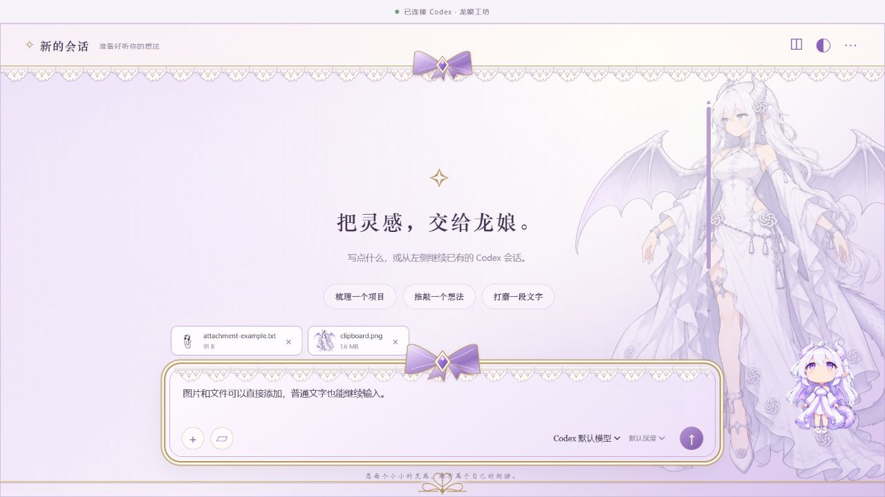

# Codex 龙娘工坊 · Dragon Atelier

连接本机 Codex 的独立聊天界面：白紫与金色装饰、蕾丝输入框、蝴蝶结、历史侧栏、龙娘背景和界面动画宠物。



本仓库只包含 **龙娘工坊客户端**。原生 Codex 龙娘宠物的制作项目和他人的 Codex 启动动画不在本仓库中。这是社区独立客户端，不是官方 Codex 主窗口的皮肤补丁。

## 快速开始

需要 Windows、已安装并登录的官方 Codex 桌面应用，以及 Python 3.10 或更新版本。运行使用 Python 标准库，无需安装额外 Python 包；启动入口会自动查找本机 Python。

```powershell
git clone https://github.com/WangYi1-1/codex-dragon-decorate.git
cd codex-dragon-decorate\CodexDragonClient
.\launch.cmd
```

也可以下载 ZIP、解压，进入 `CodexDragonClient` 后双击 **launch.cmd**。首次打开会启动本机 Codex 引擎，使用现有 ChatGPT 登录，无需填写 API Key，官方窗口关闭后也可以继续使用。默认工作目录是仓库目录，可在设置里更换。

关闭工坊窗口后，后台仍可供下次打开复用。要退出后台，运行 **stop.cmd**。服务只监听 `127.0.0.1:8741`，停止入口只关闭本项目服务和它启动的 Codex 子进程。

## 功能

- 创建、搜索、查看、继续和归档本地 Codex 历史会话；长会话分批加载。
- 按当前账号可用选项选择模型和思考深度，接收逐步回复、工具输出及操作确认。
- 拖入图片或文件、Ctrl+V 粘贴截图和文件；普通文字粘贴保持正常。
- 白紫日间与紫色夜间样式，背景开关与浓淡调整。
- 界面内的龙娘宠物跟随工作状态和鼠标视线，停留时挥手，可在设置里关闭。

PNG、JPEG、WebP 图片单张最多 20 MiB、每条消息最多 3 张；其他文件单个最多 5 MiB，一条消息最多 10 个附件。保留原图发送。

本地历史不包含 ChatGPT 网站的云端聊天。同一段会话同时只能由一个客户端写入；从原版交接时先结束回复、退出原窗口，再在工坊重试连接。云端聊天、官方内置浏览器、语音、任务调度和插件管理尚未接入。

完整操作、安装条件和故障说明见 [客户端 README](CodexDragonClient/README.md)，桥接接口见 [协议说明](CodexDragonClient/protocol/bridge-api.md)。

## 开发

```powershell
cd CodexDragonClient
python -m unittest test_bridge.py test_launcher.py
node --test test_frontend.js
```

Node.js 仅用于前端测试，运行客户端无需 Node.js。`server.py` 提供本地 HTTP/SSE 与受限 App Server RPC，`launcher.py` 和 `win_lifecycle.py` 管理 Windows 后台，`public/` 是界面。

`.gitignore` 使用发布白名单，避免把同一工作区内的其他项目、本机记录或私人数据误提交。增加公开文件时请同步更新白名单。`.runtime/` 存放缓存、浏览器资料、日志和附件，不应上传。

## 许可与素材

自写代码使用 [MIT](LICENSE)。人物背景、界面宠物图集及图标的来源和范围见 [素材说明](docs/ASSETS.md)；代码许可证不自动覆盖这些素材中的第三方角色与标识。协议 schema 的 OpenAI Codex 来源使用 Apache-2.0，详见 [第三方说明](THIRD_PARTY_NOTICES.md)。
